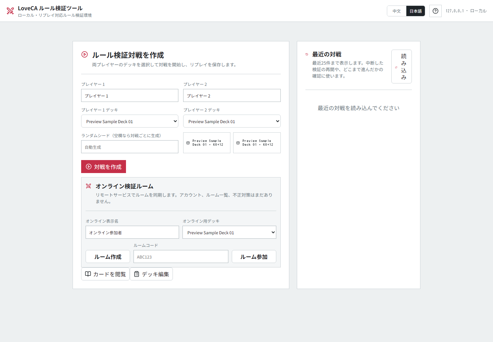
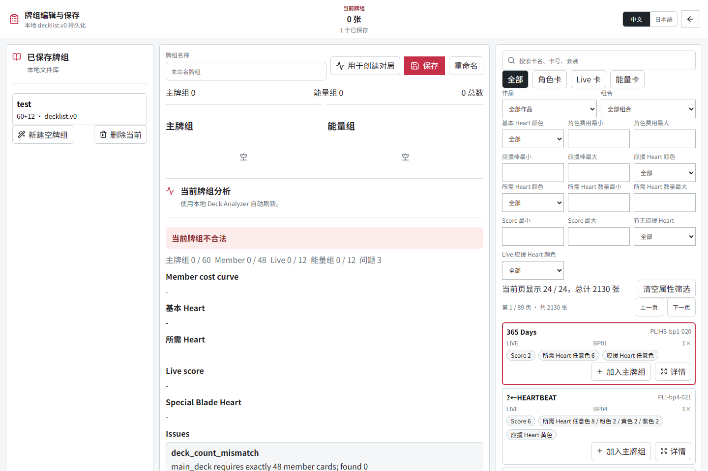
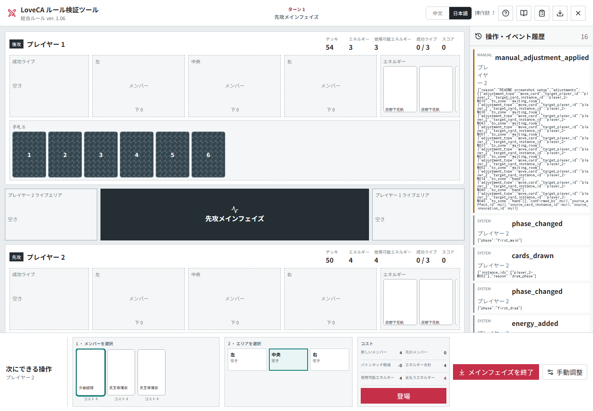
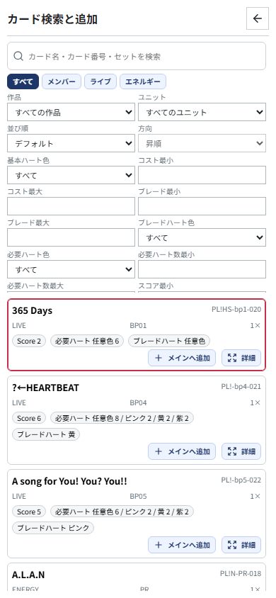
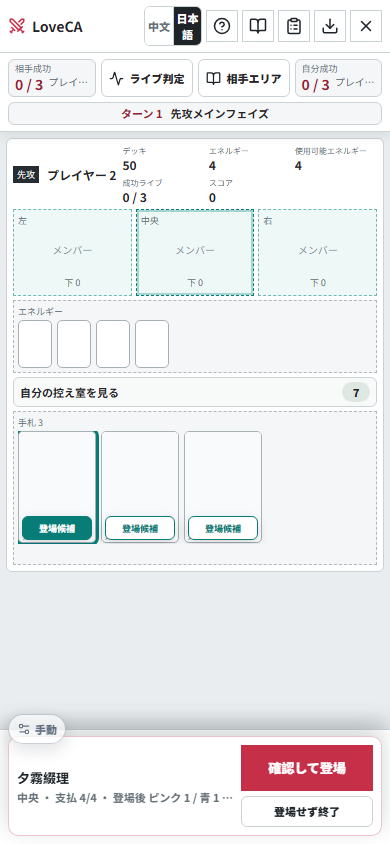

# Love Live! Series Official Card Game Analysis & Simulation Platform

[日本語](./README.md) | [简体中文](./README.zh-CN.md)

ラブライブ！シリーズ オフィシャルカードゲーム（ラブカ）のための、ローカルカードデータベース、デッキ分析、ルール検証ツールです。

公式日本語データを唯一の権威ソースとして扱います。内部の英語名は安定した実装識別子であり、公式用語の置き換えではありません。

## 現在の状態

`PL!N-sd2-005:1` 宮下 愛の「手札2枚→指定色のハート2つ」に対応しました。費用カードと色を同時に確認できるようにし、同じUI不足があった既存4能力も修正しました。元のメンバーが離場して再登場した場合は加算しません。登録906/1212（74.75%）、306件manual。[カード画像・検証](./docs/development/live-discard-color-verification.md)

`PL!SP-bp1-024:1`「Tiny Stars」の自動先頭選択を修正しました。「澁谷かのん」と「唐 可可」を名前ごとに1人選び、同じ対象にHeartとBladeを付与します。一方が不在でも他方を解決し、旧Replayは維持します。登録数は905/1212のままです。[カード画像・検証結果](./docs/development/named-live-group-verification.md)

`PL!SP-bp7-025:1`「Memories」に対応しました。ライブ開始時、同名の「嵐 千砂都」が複数いても1人を明示的に選び、そのメンバーだけがLive終了までBlade+1を得ます。対象は解決時に選び、不在なら理由を表示して終了します。登録905/1212（74.67%）、307件manual。[カード画像・状態・Replay検証](./docs/development/named-live-blade-verification.md)

効果による重複登場の監査基盤に、双方の公開Stage・表向きLive・登場候補の全文/版/ハッシュを確認する明示的な方針を追加しました。未確認能力で全エリアが利用できない場合は費用を払わず停止し、手動処理へ案内します。旧snapshotは維持し、6件の複雑な登場能力はmanualのままです。[検証と適用範囲](./docs/development/overlap-source-binding-verification.md)

`PL!SP-bp7-008:2` 若菜四季の「ウェイトでエリア移動後に自身をアクティブ」に対応しました。誘発後に離場し同じIDで再登場しても別のカードには復原せず、理由を表示して解決を完了します。完全な重複・継承の対応ではありません。[カード画像・状態・Replay検証](./docs/development/moved-source-ready-verification.md)

オンラインのプレイヤー応答から、デッキのカード情報・実ID・順序と未公開の能力定義を除き、枚数だけを表示します。自分の手札、公開カードと明示的な公開結果は維持します。完全なReplayは対戦完了/ルーム終了後に出力し、対戦中は無効です。ローカル双人検証と保存データ形式は変更しません。[検証と制限](./docs/development/player-payload-privacy-verification.md)

`PL!N-bp7-006:1` 近江彼方のEnergy支払い後の上4枚確認・並べ直しに対応しました。確認は本人だけに表示し、費用を再度払いません。第二段はmanualのままです。[カード画像・状態・Replay検証](./docs/development/activated-inspection-verification.md)

`PL!SP-bp7-008:1` 若菜四季の自己Wait→1枚ドローと、`PL!N-bp7-023:1` ミアの自己Wait→2枚ドロー後2枚捨てに対応しました。回数制限と選択の前後を区別し、manual起動のエラーも修正しました。[カード画像・状態・Replay検証](./docs/development/activated-wait-draw-verification.md)

Liveの得点・成功置き場への移動・勝敗を20場面で回帰検証し、各場面のSQLite Replayも確認します。4場面はPDF 8.4.7.1のエリア表記と既存Match Point解釈の照合が必要です。実装回帰と公式裁定の確認を区別し、エンジンや登録数は変更しません。[検証範囲と未解決点](./docs/development/live-boundary-matrix-verification.md)

効果による登場の監査用基盤で、交代する旧メンバーの自身登場・起動・Live時点能力を別メンバーの登場監視と混同しない方針を追加しました。常時・継承・未登録の原文は引き続き保留し、カードの対応数は増やしません。[検証と制限](./docs/development/disjoint-overlap-source-verification.md)

新しい対戦と待機ルームはRulesetのID・指紋・裁定パックを保存します。ルーム作成後に版が変わった場合は参加を拒否し、作り直しを案内します。旧snapshotは書き換えず、不一致の対戦は閲覧・Replay保存のみです。[ルーム互換性と清掃](./docs/development/room-ruleset-lifecycle-verification.md)

`PL!N-bp7-027`「オードリー」のライブ成功時能力に対応しました。選んだ虹ヶ咲メンバーの実効ブレードを双方の他メンバーと厳密比較し、誘発元のLiveだけに+1します。同数は加算せず、画面に比較結果を表示します。[状態・Replay・50局検証](./docs/development/selected-blade-source-score-verification.md)

`PL!N-bp3-005:1` 宮下愛の補充を正確に「3回目の登場」に限定しました。4回目以降は誘発せず、
誘発後の交代や追加登場で待機能力を失いません。別段の「2回以上」は維持します。[実カードと旧Replay検証](./docs/development/third-entry-observer-verification.md)

新規対戦では、通常交代・バトンタッチ・限定的な効果登場・手動退場でステージを離れたカードの
一時補正を解除します。再登場しても旧 Blade / Heart を引き継がず、ステージ内移動と全体補正は維持します。
旧 Replay と登録率は変更しません。[実カード・Replay・AI の検証](./docs/development/stage-departure-modifier-verification.md)

`PL!HS-pb1-009:1` のセンター誘発に限定的な重複処理を追加しました。誘発後に通常交代で離れた場合、
解決と回数は記録しますが、控え室や再登場したカードへ今回の Blade を与えません。旧 Replay は維持します。
[状態・制限・AI の検証](./docs/development/overlap-source-modifier-verification.md)

新規対戦で `PL!N-pb1-012` 鐘嵐珠が通常交代で離れた後も、誘発済みの Wait Energy 追加を解決します。
重複処理で戻った下の Energy も利用でき、不足時は結果を明示します。旧 Replay と登録率は変更しません。
[実際の状態・AI・画面の検証](./docs/development/overlap-energy-observer-verification.md)

新規対戦では複数の待機能力の解決順を選べるようにし、AP / NAP の優先と処理途中の割込み禁止を統一しました。
旧 Replay は維持します。一般のルール処理全体の完成や登録率の上昇を意味しません。
[順序・状態・AI の検証](./docs/development/pending-effect-order-verification.md)

新規対戦では `PL!N-pb1-005` 宮下愛がコスト10の Member に通常交代された際、
登場を見た後に控え室へ移っても1枚引きます。バトンタッチでは引きません。
旧 Replay の挙動は維持し、複雑な重複処理は未対応です。[検証と制限](./docs/development/overlap-entry-observer-verification.md)

効果登場の限定基盤に、非公開手札の条件付き選択を0枚にする明示的な方針を追加しました。
費用は取り消さず、旧 snapshot と公開領域の必須選択は変えません。正式カードの追加対応ではなく、
複雑な重複処理は引き続き未対応です。[画面と状態検証](./docs/development/private-hand-choice-verification.md)

`PL!SP-bp5-111:2` / `PL!SP-pb2-010:1` の Energy をデッキへ戻した後に保存データを読めなくなる問題を修正しました。
既に壊れた保存データは書き換えず、明確なエラーと新規対局の案内を表示し、再試行を停止します。
[状態・API・Replay の検証](./docs/development/energy-return-replay-verification.md)。登録率は変更していません。

継続開発は単一の `codex/continuous-development` と固定 worktree で進めます。
タスク、検証結果、PR を引き継ぐ運用は [継続開発ガイド](./docs/21-continuous-development.md)
と [実行手順](./automation/WORKFLOW.md) を参照してください。

[Codex Cloud への引き継ぎ](./docs/development/codex-cloud-handoff.md)を準備しました。
Linux のセットアップとタスク状態を共有できますが、実行元はまだローカルです。
クラウドへの切替・定期実行・同一 PR 更新は別途確認し、認証情報や本番環境は移しません。

旧 worktree から公式ルール ver.1.06 の読み取り専用 Profile と 49 件の条項参照を移行しました。
FAQ は未審査のため非適用です。対局 / Replay への接続とルール行列は次の工程であり、
今回の資料検証だけで v0.9 準拠を宣言しません。[移行範囲](./docs/22-ruleset-source-profile-migration.md)

Deck Builder の詳細画面では、明示的に選んだカード画像をデータ再取得後も保持します。
別カードを開いた場合は、そのカードの印刷版から選び直します。

API Play 検証ツールは、対戦相手の裏向きカードと他プレイヤーの非公開選択を入力から隠します。
mock と実モデルの検証を区別し、context 保存は既定で無効です。このツール移行だけでは技能対応率を変更しません。

`PL!-bp5-003:2` の起動能力を構造化しました。実際に支払った手札に応じて、
4枚確認から2枚を手札へ、または控え室のライブ1枚回収へ分岐します。
確認中のカードは相手の画面 / AI に渡さず、費用選択から次の選択へ移る際に UI を初期化します。
[検証記録](./docs/development/cost-result-branch-verification.md)

`PL!-PR-015` / `PL!SP-PR-020` の手動能力案内は、低コストのメンバーから実際に
バトンタッチした場合だけ表示します。効果による登場は区域 / 向きの基盤が未整備のため、
この2枚は引き続き手動処理です。[監査記録](./docs/development/baton-hand-deploy-audit.md)
旧効果登場10件を再確認し、空きエリア指定の6件を Active 登場と位置選択に修正しました。
空きエリア限定ではない虹ヶ咲4件は手動処理へ戻しました。旧 Replay の向きは維持します。
[検証と未対応範囲](./docs/development/empty-effect-deployment-verification.md)。登録率はルール正確性の保証ではありません。

新規対戦では、同一ターンの登場先制限がメンバーカードの現在位置に追従します。
ポジション / フォーメーションチェンジ後に元のエリアだけが制限される問題を修正し、
下に重なる新規 Member も判定対象としました。旧 Replay の動作は維持します。
[検証記録](./docs/development/member-entry-area-history-verification.md)

`PL!-bp6-003:2` で下のメンバーを空きエリアへ移した際、登場能力が余分に誘発する問題を修正しました。
新しい技能 snapshot はエリア間移動として扱い、旧 Replay の結果は維持します。
結果画面でも処理の違いを表示します。[検証と残課題](./docs/development/attachment-promotion-verification.md)

`PL!-pb1-018:1` の双方控え室登場で登場能力が誘発しない問題を修正しました。
双方がカード・空きエリアを選んでから同時にウェイトで登場し、その後に能力を処理します。
選択画面と旧 Replay の互換性も検証しました。[検証記録](./docs/development/multi-player-entry-verification.md)

既存メンバーのいるエリアへの効果登場は、限定的な実行基盤を検証中です。
複雑な重複処理・手札の非公開選択は未完了のため、PR2枚と虹ヶ咲4枚はまだ手動処理です。
[検証範囲と新たな Replay 課題](./docs/development/occupied-deployment-foundation.md)を公開し、対応率は増やしていません。

`develop`（次期 `v0.9`）の収録内容:

- 公式 `card_list` JSON API からの正式カード importer
- `＋` / `+` 混在を避けるカード番号正規化
- SQLite Schema v2 のローカルカード DB
- デッキ保存機能付き Deck Builder
- `decklist.v0` ベースの Deck Analyzer
- FastAPI + React SPA の可視化ルール検証 UI
- Replay 可能な Action-only GameState
- 2026-10-24 発売の `CLLS01` と、`PBLL02` / `BP07` / `NSD02` まで含む locked card database
  - 1,977 Gameplay Cards / 2,700 printings / 1,246 text revisions / 24 Card Sets
  - importer は公式 products API を優先し、カードリスト未公開の将来商品や unit filter を set として誤取得しません
- 1,212 件の effect registry entry
  - 900 件（74.26%）は `test_validated_executable`
  - 312 件は timing prompt / 未対応処理用の `manual_resolution`
  - 新パックで見つかった未対応効果も manual として明示登録し、silent skip を防止
- 将来の低コスト online 同期に向けた state hash / compatibility metadata の基礎
- Hosted Online MVP の room API
  - room code による host / guest 参加
  - HTTP polling による状態同期
  - Python Rule Engine をサーバー側で再利用
  - 24 時間 TTL の一時 room
  - server は毎日 JST 04:00 に自動再起動し、runtime cache を整理する想定
- locked authoritative card SQLite
  - CI、Docker、Pages data export は repository 内の `data/loveca.sqlite3` を使用
  - `data/loveca-db-manifest.json` が DB / effect registry fingerprint を記録
- GitHub Pages browser preview 用の静的 SPA release workflow
  - preview data package は解析済みカード / skill data のみを含む
  - カード画像は同梱せず、公式 `image_url` を参照する
  - 初回起動時に 5 個の合法な `decklist.v0` preview sample deck を browser localStorage に作成
  - decklist.v0 JSON の import / export に対応

現在の開発主線:

- Roadmap 上は Phase 5 を維持フェーズへ移しつつ、Phase 6 の公式ルール準拠と構造化効果の正確性を進めています。
- Phase 1 / 2 / 3 は基本実装済みで、維持と改善の段階です。
- Phase 4 の Human-vs-Human 検証器と Phase 7 の UI は先行実装済みです。
- Phase 9 / 10 の低コスト online 検証は、Phase 5 と並行して早めに進めます。
- Simple AI v1.1 は local / Hosted FastAPI で利用でき、Rule Engine の評価値を使って Member、Live、構造化能力を deterministic に採点します。旧 Replay 用の v0 / v1 policy も保持しています。MCTS、Monte Carlo、学習型 AI、勝率エンジンは対象外です。
- 実験用 `simple_ai_v1_2` は Live がない時に余剰 Member を最大3枚セットして引き直します。同一20デッキ・50局で平均7.64→5.94ターン、先頭10局は全て10ターン以内かつ双方成功Liveあり。既定はv1.1のままです。[検証と制限](docs/development/ai-live-cycle-verification.md)
- 旧30デッキを固定した別の50局も比較可能になりました。同じ260操作上限で旧heuristic 34完走、v1.1 42、v1.2 48です。v1.2には未対応能力の明示skipが3件あり、完全なルール適合とは別の評価です。[固定デッキ検証](docs/development/ai-frozen-pool-verification.md)

現在のルール検証 UI で確認できる範囲:

- 先攻後攻決定、初手、マリガン、初期 Energy
- Member 登場、満員時の置き換え、`バトンタッチ`
- Live Set、同数補充、Live 公開、エール
- Heart 割り当て、特殊 Blade Heart の一部自動処理
- 成功 Live の移動、次ターン先攻判定、3 枚成功による勝敗
- 一部のカード効果は、手札 / Energy / Stage Member / Heart 色 / 山札上確認を含む限定的な構造化 prompt に対応
- 双方が選択する一部の効果は multi-player pending choice で順番に処理可能
- 複数 group に分けて Stage Member を選び、それぞれに同じ一時 modifier を適用する効果に対応
- 分岐ごとに異なる Stage Member 候補を持つ効果選択に対応
- registry entry ベースの `test_validated_executable` coverage は 74.26%（900 / 1,212）。未対応の新効果と、監査で不正確と分かった旧登場効果は明示的に manual とします
- `PBSP02` 関連 effect は 74 件中 63 件を構造化し、新パック内 coverage 85.14% を確認済み
- μ's / Aqours / Saint Snow / Nijigasaki / Hasunosora / Edel Note の一部控室回収、Energy ready、山札上確認、Yell 公開条件、手札コスト付き Live 開始時効果を追加で構造化
- static Heart / Blade などの常時効果は、operation 側の条件を満たす場合だけ加算するようにしています
- `PBSP02` 集中 block sandbox は `30 decks x 20 matches` で 19 完走、`mandatory_manual_resolution = 0`、残り 1 件は `max_actions:match_point_players_have_no_live_in_hand`
- Phase 5 broad black-box sandbox は `30 decks x 100 matches` の block mode で `100/100` 完走、blocker 0 を確認済み
- 最新の skill-dense Simple AI regression は `30 decks x 100 matches` で 100/100 完走、blocker / silent skip / Replay error 0
- 以前の問題カード targeted sandbox で blocker だった `PL!S-bp6-001:1` / `PL!S-pb1-001:1` は現在構造化済み。未対応 312 件は gap report で理由を管理します
- `LL-bp5-002:1` の「Stage に異なるグループ名の Member が 3 人以上なら、Center Member が Live 終了まで任意色 Heart を得る」処理を構造化しました
- 2026-10 全量同期後の公式総合ルール ver.1.06 AI 逐 Action 監査は 20/20 完走、13/20 が「10 turn 以内かつ双方 1 回以上 Live 成功」を満たし、13,539 件の check、Replay error / effect-error skip 0 でした
- 最新の 30 deck / 50 match black-box run は executable effect 314/314、skipped effect 0、Replay error 0。34 局が完走し、残る 16 局は Live access / 長局戦略により action cap に達したため、Rule Engine の不正 Action ではなく AI 方策課題として追跡します
- Live 判定は 9 つの固定境界でも監査し、Live 成功、今回の勝者、Match Point 時の成功 Live 追加可否、最終勝敗を別々に確認します
- trigger 時に条件を満たした pending effect が、同一タイミング中の別効果で条件失効した場合は、明示的な `effect_not_activatable` event を残して進行可能
- 公開して手札に加える効果は、相手側の履歴にも公開カード名が残るようにしています
- 60 件の日本語 / 中文 human-readable effect 検証シナリオで重点効果を確認でき、そのうち 21 件は実際の GameState 遷移を検証します
- Simple AI v1.1 / v1 の 200-match mirrored benchmark は 200/200 完走、v1.1 54%、平均 8.38 turn、P95 14 turn、decision P95 6.975 ms、illegal action / Replay error 0 です。未対応効果 19 件は silent 処理せず明示的に skip 記録され、55% 強度目標は未達です
- `amount_source=selected_count` を使う効果は、選んだ枚数分の抽牌に対応しています
- `PL!HS-bp6-006` は手札中の cost reduction、みらくらぱーく！以外との Baton replacement 制限、Live 成功時の Wait + 次 Active Phase 非アクティブ化を構造化しています
- `PL!HS-bp6-014:1` など手札から起動する効果は、対象 Stage Member がいない場合でもコスト支払いと抽牌を処理し、対象 modifier だけを空解決できます
- 二段階効果は follow-up choice 開始時に `effect_choice_started` event を出し、UI / replay / sandbox report で「続きの選択待ち」を確認できます
- local / Hosted FastAPI では Player 2 を `simple_ai` にした対コンピューター戦を作成できます。AI は LegalAction のみから選択し、判断理由を event / replay に残します
- Simple AI acceptance は 20 decks を使った Human-vs-AI 20 局 + AI-vs-AI 20 局で `40/40` 完走、blocker 0、Replay error 0 を確認済みです
- CPU が安全に処理できない操作や連続 action 上限に達した場合は、source card / timing を含む `ai_blocked` event を runtime と Replay に保存し、UI から処理可能な操作へ移動できます
- 自動実行できない効果は `ManualAdjustmentAction` で補完
- 処理不能な効果は、デバッグ用に `effect_skipped_due_to_error` として明示記録しながらスキップ可能

Deck Builder の現在の到達点:

- 保存済みデッキの作成、読み込み、更新、削除
- 画面内の折りたたみ式 manual で、検索、投入、構築条件、分析、保存、共有、対戦利用の流れを確認可能
- `Member` / `Live` / `Energy` の分割表示
- `Member 48` / `Live 12` / `Energy 12` の構築数チェック
- 作品、ユニット、Heart 色、Blade、Live 必要 Heart、Score、Blade Heart による絞り込み
- カード詳細ダイアログでの印刷版選択とカード画像確認
- デッキ分析 dashboard による cost、Heart、score、特殊 Blade Heart、効果タイミングの確認

未実装または未収録:

- 全カード効果の自動化
- 全量カードプールに対する完全な効果 prompt coverage
- 強い AI、Monte Carlo、勝率エンジン
- Simple AI は合法性と進行を優先する deterministic policy で、対戦強度や最適プレイは保証しません
- 本格的な online 運用、アカウント、ユーザー同期、不正対策
- GitHub Pages preview は解析済み data package を同梱した場合、FastAPI なしでカードカタログ閲覧、browser local deck 保存、MVP deck 分析まで動作します。対戦は runtime config の `apiBaseUrl` を設定した場合のみ Hosted FastAPI に接続できます。

## フィードバックと対戦相手募集

バグ報告、ルール挙動の相談、online 対戦相手探しは [Discord](https://discord.gg/8uYQH7z8) を使ってください。報告時は、できれば利用中の版、ローカル / Hosted / Pages preview のどれか、再現手順、decklist.v0 JSON、Replay JSON、スクリーンショットを添えてください。

## 既知の制限

- これは開発中の alpha 版です。公式アプリではなく、ルール検証とプレイテスト feedback を集めるためのツールです。
- 全カード効果の自動実行 coverage はまだありません。未対応効果は `ManualAdjustmentAction`、構造化 pending choice、またはデバッグ用 skip で進行する場合があります。
- 現在 312 件を `manual_resolution` として明示保持しています。未登場または複雑な技能は引き続き manual となり、最新の分類は `docs/13-effect-semantics-audit.md` と `TODO.md` に記録します。
- `BP07` の `無2` 特殊 Blade Heart は総合ルール ver.1.06 だけでは意味を確定できないため、推測実装せず未対応として保持しています。
- FAQ / 個別裁定に依存する効果はまだ仕様化していません。
- `data/loveca.sqlite3` は repository 内の locked authoritative card DB です。公式カード追加や parser / schema / effect registry の互換性変更後は、maintainer が DB と `data/loveca-db-manifest.json` を再生成して commit します。ユーザーや CI が online 用に別 DB を import してはいけません。保存済みデッキは `decklist.v0` のユーザーデータなので、カード DB とは分けて保持できます。
- Web/API テストには `httpx2` が必要です。環境に未導入の場合、`tests/test_catalog_api.py` と `tests/test_webapp.py` は収集段階で停止します。
- Hosted Online MVP は低コスト検証用です。ルール判定は FastAPI 側の Python engine が行いますが、アカウント、恒久保存、厳密な不正対策はありません。
- Hosted API の runtime DB は一時データです。最近 25 件の match history と各 match の直近 snapshot だけを保つ方針で、毎日 JST 04:00 の自動再起動時にも cleanup が走ります。Online room が切れた場合は新しく作り直してください。
- 公開 Hosted API では全体の match history を表示しません。ソロ検証 match は作成したブラウザの localStorage に保存した access token で復帰します。管理者用 runtime 確認 / cleanup API は `LOVECA_ADMIN_KEY` が必要です。
- GitHub Pages browser preview はカード閲覧、Deck Builder、decklist.v0 import / export、MVP deck 分析を主目的にしています。対戦は Hosted API が設定された環境でのみ利用できます。

## UI 機能と使い方

### ホーム / 対戦開始

- 画面右上の言語切り替えで、簡体中文 UI と日本語 UI を切り替えられます。選択は browser localStorage に保存されます。
- 保存済みデッキ、または Deck Builder から戻した編集中デッキを選び、ローカル検証用の対戦を作成できます。
- Hosted API が設定されている環境では、room code を発行して host / guest がそれぞれデッキを持ち寄る online room を作成・参加できます。Online match では自分の盤面が常に画面下側に表示され、Action Dock は現在の room token で送信できる action だけを表示します。
- Browser preview では、同梱済みカードデータ、5 個の合法な初期 `decklist.v0` sample deck、localStorage 保存、decklist.v0 import / export、MVP deck 分析を利用できます。対戦は runtime config の `apiBaseUrl` が設定されている場合だけ Hosted API に接続します。

### カードカタログ

- 読み取り専用のカード一覧です。検索欄とカード種別、作品、ユニットの filter でカードを絞り込めます。
- 一覧からカードを選ぶと、カード画像、Cost / Blade / Score、Heart、作品 / ユニット、公式効果テキスト、review candidate、source observation を確認できます。
- 画像はローカル cache がある場合は `/api/card-images/*` を優先し、なければ公式 `image_url` に fallback します。

### Deck Builder

- 保存済みデッキの作成、読み込み、上書き保存、名前変更、削除ができます。
- 画面上部の「Deck Builder 使い方マニュアル」から、検索、投入、構築条件、分析、保存、共有、対戦利用の流れを確認できます。
- decklist.v0 JSON の import / export に対応しているため、browser preview とローカル環境の間でデッキを移動できます。
- `Member` / `Live` / `Energy` を分けて表示し、`Member 48` / `Live 12` / `Energy 12` と同名カード上限を UI 上で確認しながら編集できます。
- カード検索は、カード名 / カード番号の検索、カード種別、作品、ユニット、Member の基本 Heart / Cost / Blade / Blade Heart、Live の必要 Heart / Score / Blade Heart で絞り込めます。検索結果は card code、card name、card type、Member cost、Blade、Live 必要 Heart、Live score、現在の投入枚数で並び替えできます。
- 検索結果のカードは詳細 dialog で画像と主要 stat を確認でき、追加ボタンでデッキへ投入できます。
- 右側の分析 dashboard は自動更新され、構築合法性、枚数問題、Member cost curve、基本 Heart、Live 必要 Heart、Score、特殊 Blade Heart、効果 timing / execution summary を確認できます。
- 共有 UUID は現在のデッキだけを server に一時 upload し、相手が UUID で取り込んだ時だけ相手のローカル保存一覧に追加されます。通常の保存済み deck list は引き続き各ブラウザ / ローカル環境に保持されます。
- Deck Builder で選んだデッキは「対戦に使う」操作でホームへ戻し、ローカル対戦または online room の deck source として使えます。

### ルール検証 UI

- Match 画面では、双方のステージ、手札・山札・控え室などの zone count、Live / Energy / Heart 状態、現在 phase、turn number を同じ画面で追跡できます。
- モバイルでは自分の手札カードを大きめに表示し、Member 登場はカード下の登場候補ボタン、エリア選択、確認ボタンで送信できます。カード本体のタップは詳細確認に使えます。成功 Live 進捗、Live 判定、相手エリアは必要に応じて pop-up で確認できます。
- Live 判定 pop-up からそのまま次の処理へ進めます。次ターン開始時は pop-up を閉じ、無意味な完了画面を残さないようにしています。
- 初期 mulligan は Member 登場と同じく、カード選択と確認を分けた操作として扱います。
- Action Dock には現在実行可能な action が表示され、Member 登場、Baton Touch、Live Set、mulligan、Heart 割り当て、pending effect 解決などを UI から送信できます。
- 一部の効果は構造化 prompt として表示され、対象カード選択、choice branch、inspection / reveal の並べ替えや移動先選択を UI 上で処理できます。
- 自動実行できない効果は `ManualAdjustmentAction` drawer で、カード移動、Heart 補正、Live success 補正、任意メモを入力して検証を継続できます。
- Action/Event Log、Live judgment detail、effect activation summary、カード詳細 dialog を使って、rule engine が何を処理したかを確認できます。
- ローカル match と online room match は Replay JSON export に対応しています。Browser preview 単体では Replay export は無効です。

## 画面イメージ

PC 開始画面: 保存済みデッキを選び、そのまま対局作成まで進められます。



PC Deck Builder: 右側でカード検索と絞り込み、中央で構築内容と分析結果を確認します。



PC ルール検証 UI: 盤面、Action/Event Log、手動調整を同じ画面で追えます。



スマホ Deck Builder: カード検索はポップアップで開き、検索条件と追加操作を縦画面で確認できます。



スマホ ルール検証 UI: 自分の盤面と手札を中心に表示し、登場確認や手動調整は小型の操作入口から行います。



## カード DB と asset 配布方針

将来的には、構築済みの SQLite カード DB、effect registry、manifest、checksum を含む versioned asset package を配布し、ユーザーが公式サイトから毎回全量取得しなくても起動できる形にできます。

ただし、公式効果テキスト全文、公式 PDF 由来の大量データ、ダウンロード済みカード画像ファイルは再配布可否の確認が必要です。GitHub Pages preview で公開する asset は、解析済みカード data、解析済み skill data、manifest、checksum、プロジェクト独自 metadata に限定し、カード画像は同梱せず公式 `image_url` を参照する方針です。

公開 preview は専用の `preview` ブランチから配信します。このブランチでは review 済みの `data/loveca.sqlite3` を直接コミットし、GitHub Pages workflow はその SQLite から静的 JSON を生成します。`develop` の頻繁な更新では Pages を再構築せず、preview を更新したいタイミングだけ `preview` ブランチへ反映します。

browser preview の deck は localStorage に保存されます。Deck はカード番号と枚数中心の小さな JSON なので、5 個の合法な初期 `decklist.v0` sample deck と通常のユーザー deck では容量は小さく収まります。移行や共有が必要な場合は、Deck Builder の JSON import / export を使用してください。

private tester 向けに事前構築 DB を渡す場合も、release version、schema version、parser version、card database fingerprint、effect registry hash を明示し、互換性が崩れる更新後は再導入が必要です。

## 変更履歴

リリースごとの詳細は [CHANGELOG.md](./CHANGELOG.md) を参照してください。

## リポジトリの見どころ

- `TODO.md`: 低優先度の既知タスク
- `src/loveca/cards/`: importer、catalog、画像キャッシュ
- `src/loveca/decks/`: deck format、analyzer、saved deck library
- `src/loveca/simulation/`: GameState、Action、runtime、effects
- `src/loveca/webapp.py`: FastAPI と SPA 配信
- `web/`: React ベースのルール検証 UI
- `docs/`, `specs/`: 設計文書と仕様
- `docs/14-database-migration-and-update-guide.md`: SQLite の再構築、増分更新、runtime lifecycle 指針
- `docs/15-project-guidance.md`: changelog 言語などの保守指針
- `docs/16-low-cost-online-battle-plan.md`: 低コストなネットワーク対戦検証モードの計画
- `docs/17-browser-only-preview-and-pages-release.md`: GitHub Pages browser preview と静的 data package の計画
- `docs/18-hosted-online-smoke-checklist.md`: Hosted Online MVP の merge / deploy 前 smoke checklist
- `docs/19-ai-rule-conformance-and-strategy-audit.md`: AI 対戦と公式ルール適合性の監査基準
- `docs/20-ai-dlc-development-workflow.md`: AI-DLC を使う開発、承認、vendor 更新手順

## ローカル環境構築と開発コマンド

### 動作環境

- Python `3.11+`
- Node.js `20` / `22` / `24+`
- Bun（AI-DLC workflow を使う開発者のみ）
- SQLite は追加セットアップ不要

インストール:

```powershell
python -m pip install -e ".[dev]"
cd web
npm install
cd ..
```

AI-DLC を使う場合:

```powershell
npm install -g bun
python scripts/aidlc_vendor.py verify
bun .codex/tools/aidlc-utility.ts doctor
```

新しい Codex session で `.codex/hooks.json` を確認して hook trust を承認し、
`$aidlc compose "変更内容"` から開始します。詳細は
`docs/20-ai-dlc-development-workflow.md` を参照してください。

### ローカル起動

1. カード DB を初期化します。

```powershell
loveca cards init --database data/loveca.sqlite3
```

バージョン更新後に importer / parser / schema が変わった場合は、古い `data/loveca.sqlite3` をバックアップまたは削除してから、この手順でカード DB を作り直してください。古い DB を使い続けると、カード番号、画像、effect registry、online compatibility fingerprint が一致しないことがあります。

2. 公式カードを取得して正規化成果物を作ります。

```powershell
loveca cards import-official `
  --output-root data/imports/official `
  --delay 1
```

3. 正規化済みカードを SQLite に取り込みます。

```powershell
loveca cards import `
  --database data/loveca.sqlite3 `
  --input data/imports/official/normalized/cards-official.json `
  --normalization data_sources/card-entity-normalization.json `
  --report logs/import-full.md
```

4. フロントエンドをビルドします。

```powershell
cd web
npm run build
cd ..
```

5. 必要ならカード画像をローカルにキャッシュします。

```powershell
loveca cards cache-images `
  --database data/loveca.sqlite3 `
  --cache-dir data/card_images `
  --delay 1
```

6. Web UI を起動します。

```powershell
loveca web serve `
  --database data/loveca.sqlite3 `
  --matches data/matches.sqlite3 `
  --image-cache data/card_images `
  --host 127.0.0.1 `
  --port 8765
```

ブラウザで <http://127.0.0.1:8765> を開きます。

`8765` が使用中なら `--port 8766` のように変更してください。

### Docker API サーバー

Cloudflare Worker gateway、Caddy、小型 VM で Hosted Online MVP を試す場合は、FastAPI backend だけを Docker で起動できます。

前提:

- locked `data/loveca.sqlite3` が repository に commit されていること
- `runtime/` と `logs/` はホスト側に保持すること
- GitHub Pages から接続する場合は `LOVECA_ALLOWED_ORIGINS` に Pages URL を設定すること

ローカル build:

```powershell
docker build -t loveca-simulator-api:local .
```

compose 起動:

```powershell
$env:LOVECA_ALLOWED_ORIGINS="https://smaillion.github.io,http://127.0.0.1:8765,http://localhost:8765"
docker compose -f compose.api.yml up -d --build
```

health check:

```powershell
curl http://127.0.0.1:8765/api/health
```

推奨する低コスト構成では、Cloudflare Worker の `workers.dev` URL を安定 API gateway として使います。VPS 側は Caddy で secret 管理された origin hostname の `/api/*` を公開し、`127.0.0.1:8765` に reverse proxy します。

GitHub Actions:

- `.github/workflows/api-image.yml` は Docker image を build します。
- Pull Request では build 検証のみ行います。
- `api-image.yml` は `develop` / `preview` への push または手動実行で GHCR に `ghcr.io/smaillion/loveca-simulator-api` として push します。
- `.github/workflows/deploy-api.yml` は `develop` への push または手動実行で GHCR image を build / push し、SSH で VPS 上の compose service を更新します。
- `.github/workflows/deploy-worker.yml` は `develop` / `preview` の Worker 変更、または手動実行で Cloudflare Worker gateway を更新します。
- `.github/workflows/pages-preview.yml` は `preview` への push または手動実行で GitHub Pages preview を公開します。
- `main` への push は現段階では自動 publish / deploy を行いません。production 相当の release promotion は maintainer の明示的な手動実行または専用 release 手順で行います。

Deploy に必要な GitHub Secrets:

- `DEPLOY_HOST`
- `DEPLOY_USER`
- `DEPLOY_SSH_KEY`
- `DEPLOY_PATH`
- `ORIGIN_API_BASE_URL`
- `LOVECA_ALLOWED_ORIGINS`
- `CLOUDFLARE_API_TOKEN`

GitHub Pages から Hosted API に接続する場合は、repository variable `VITE_PUBLIC_API_BASE_URL` に Cloudflare Worker URL を設定してください。

### よく使うコマンド

Deck Analyzer:

```powershell
loveca decks analyze `
  --database data/loveca.sqlite3 `
  --deck data/decks/your-deck.json `
  --output text
```

増分インポート:

```powershell
loveca cards import-official `
  --output-root data/imports/official-bp07-nsd02 `
  --mode incremental-set `
  --card-set BP07 `
  --card-set NSD02 `
  --delay 1
```

```powershell
loveca cards import `
  --database data/loveca.sqlite3 `
  --input data/imports/official/normalized/cards-official.json `
  --normalization data_sources/card-entity-normalization.json `
  --card-set BP07 `
  --card-set NSD02 `
  --report logs/import-bp07-nsd02.md
```

### テスト

Python テスト:

```powershell
python -m pytest
```

AI sandbox の 20 deck x 20 match ブラックボックス smoke も pytest に含まれています。
ローカル正式カード DB がない環境では skip されます。個別に監査レポートを生成する場合:

```powershell
$env:PYTHONPATH="src;."
python -m tools.ai_sandbox.blackbox_playtest `
  --database data/loveca.sqlite3 `
  --output logs/ai_sandbox/manual-run `
  --decks 20 `
  --matches 20 `
  --manual-policy block
```

`--manual-policy skip` を指定すると、未対応の強制能力を
`effect_skipped_due_to_error` として記録しながら次の処理へ進めます。
これはルール確認用のデバッグ機能であり、正式な能力解決ではありません。

Phase 5 の手動効果検証には semantic user-agent sandbox も使えます。これは通常行動は
deterministic sandbox policy で進め、`manual_resolution` 効果だけを semantic provider に
渡して、現在の `ManualAdjustmentAction` で人間相当の処理が可能かを測る補助ツールです。
registry coverage には加算しません。未設定時は `mock` provider になり、実効果は解決せず
report と schema gap の出力だけを確認します。

```powershell
$env:PYTHONPATH="src;."
python -m tools.ai_sandbox.semantic_playtest `
  --database data/loveca.sqlite3 `
  --output logs/semantic_sandbox/manual-run `
  --decks 30 `
  --matches 20 `
  --max-actions 260 `
  --manual-fallback skip
```

二人の semantic agent に通常行動も選ばせたい場合は、`--two-agent` を使います。
このモードでは `raw_doc/LoveLiveTCG_cr_1.06_260428.pdf` を `pypdf` で抽出し、
現在操作するプレイヤーの非公開情報だけを含めた context を provider に渡します。
未設定の `mock` provider では普通行動を選ばず、deterministic fallback で配管だけを検証します。

```powershell
$env:PYTHONPATH="src;."
$env:LOVECA_SEMANTIC_AGENT_PROVIDER="openai_compatible"
$env:LOVECA_SEMANTIC_AGENT_MODEL="..."
$env:LOVECA_SEMANTIC_AGENT_API_BASE="..."
$env:LOVECA_SEMANTIC_AGENT_API_KEY="..."
python -m tools.ai_sandbox.semantic_playtest `
  --database data/loveca.sqlite3 `
  --output logs/semantic_sandbox/two-agent-large `
  --decks 30 `
  --matches 100 `
  --max-actions 360 `
  --manual-fallback skip `
  --two-agent `
  --play-fallback deterministic
```

個別 effect の挙動を人間が読みやすい形で確認したい場合は、effect verification report を
生成できます。日文主レポート、中文レポート、JSON summary を出力し、ローカルカード DB から
取得できる公式画像 URL も Markdown に埋め込みます。現在は本分支で重点修正した
`PL!HS-bp6-014` の手札起動、`PL!HS-bp6-006` の登場 cost / Live 成功時処理、
`PL!HS-bp2-026` の score modifier、Baton Touch 二重防止、`PL!HS-sd1-005`
の同名 Baton 条件を固定検証します。

```powershell
$env:PYTHONPATH="src;."
python -m tools.ai_sandbox.effect_verification_report `
  --output logs/effect_verification/manual-run
```

OpenAI-compatible provider を使う場合は以下を設定します。

```powershell
$env:LOVECA_SEMANTIC_AGENT_PROVIDER="openai_compatible"
$env:LOVECA_SEMANTIC_AGENT_MODEL="..."
$env:LOVECA_SEMANTIC_AGENT_API_BASE="..."
$env:LOVECA_SEMANTIC_AGENT_API_KEY="..."
```

フロントエンドテスト:

```powershell
cd web
npm run test -- --run
npm run build
```
