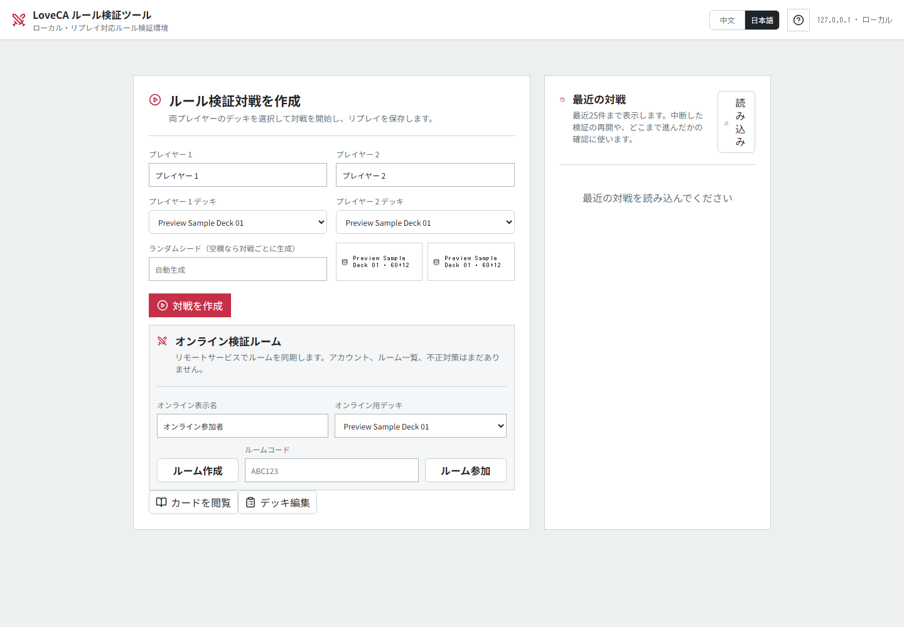
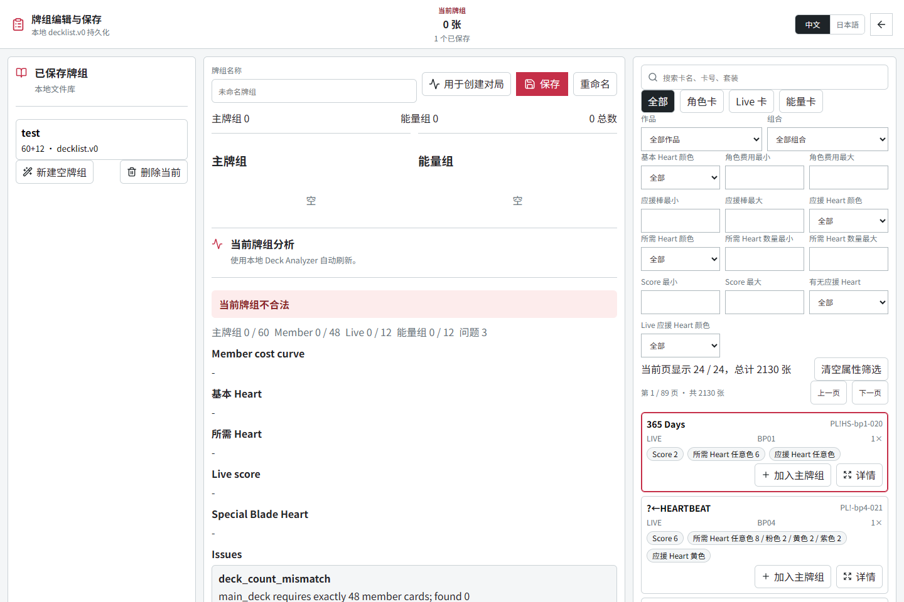
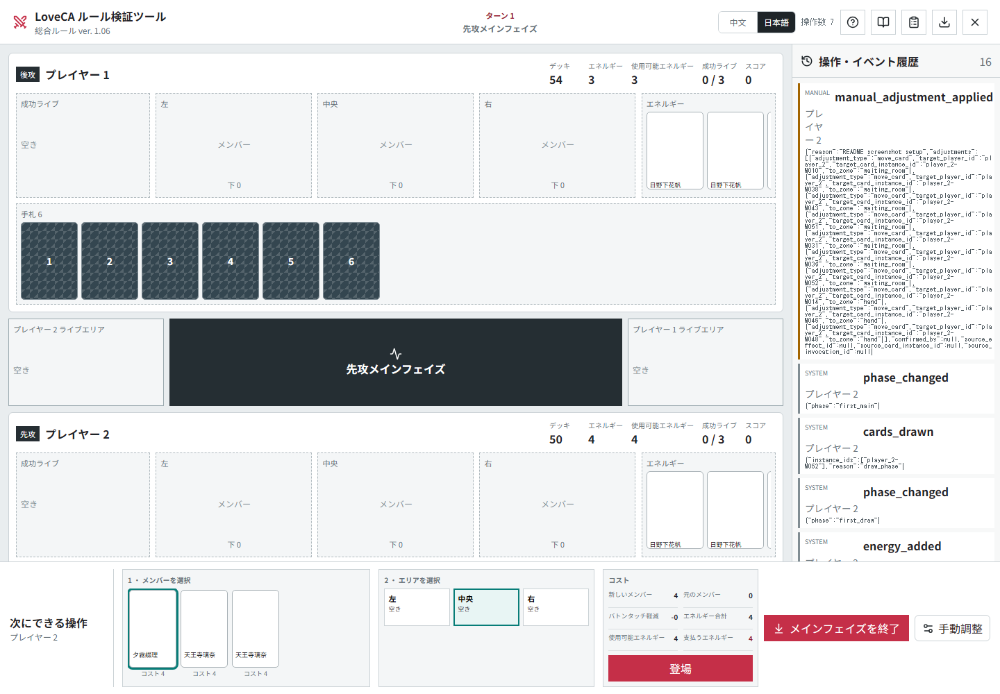
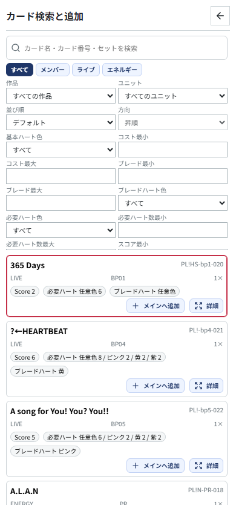
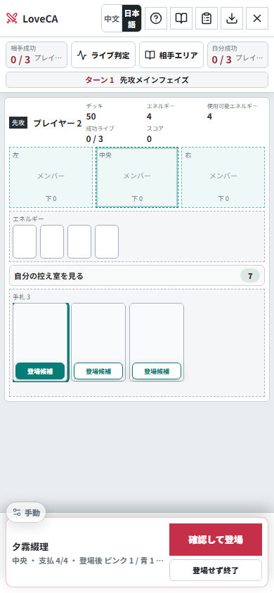

# Love Live! Series Official Card Game Analysis & Simulation Platform

[日本語](./README.md) | [简体中文](./README.zh-CN.md)

面向 Love Live! Series Official Card Game（ラブカ）的本地卡牌数据库、牌组分析与规则验证工具。
官方日文资料是规则权威来源；内部英文标识只用于工程实现。本项目不是官方数字客户端，目前处于 alpha 阶段。

## 当前状态

- 卡牌目录、Deck Builder、牌组导入导出与基础分析可用。
- 规则验证器支持 Member 登场、Baton、Live 判定、结构化技能选择、人工调整与 Replay。
- 本地和 Hosted API 支持人机对局；默认 Simple AI v1.1，v1.2 是可选实验策略，不保证最优策略或全卡自动化。
- Hosted Online 提供房间码联机；纯静态 Browser Preview 提供卡库和组牌，对战需要配置 Hosted API。
- 未支持或规则依据不足的能力保持人工处理。原型通过、登记为可执行、完整对局验收和正式发布是不同状态，不能互相替代。

当前任务、规则边界、逐卡证据及发布状态的查阅方法统一放在[文档导航](./docs/README.md)；
逐轮变化只记入[变更记录](./CHANGELOG.md)，不再把历史测试数或旧 PR 状态累加到本页。

## 反馈与约战

Bug 报告、规则行为讨论和 online 对战伙伴寻找请前往 [Discord](https://discord.gg/8uYQH7z8)。报告问题时，请尽量附上版本、运行方式是本地 / Hosted / Pages preview、复现步骤、decklist.v0 JSON、Replay JSON 和截图。

## 已知限制

- 这是开发中的 alpha 版本，不是官方数字客户端。当前目标是规则验证和收集 playtest feedback。
- 还没有覆盖全卡技能自动执行。未支持技能可能需要 `ManualAdjustmentAction`、结构化 pending choice，或用调试 skip 继续推进。
- 未支持能力保持 `manual_resolution`；当前登记以锁定 registry 为准，语义限制见[专题证据导航](./docs/development/README.md)。测试或登记数量不等于完整规则覆盖率。
- `BP07` 的 `無2` 特殊 Blade Heart 无法仅凭综合规则 ver.1.06 确定语义，因此不会猜测实现，当前保持未支持状态。
- 依赖 FAQ 或个别裁定的效果尚未规格化。
- `data/loveca.sqlite3` 是仓库内锁版本权威卡牌 DB。官方补充包或 parser/schema/effect registry 变化后，由维护者重建并提交新的 DB 与 `data/loveca-db-manifest.json`；普通用户和 CI 不应自行 import 产生不同线上 DB。保存牌组是 `decklist.v0` 用户数据，可以和卡牌数据库分开保留。
- Web/API 测试依赖 `httpx2`。环境缺少该依赖时，`tests/test_catalog_api.py` 和 `tests/test_webapp.py` 会在收集阶段停止。
- Hosted Online MVP 只用于低成本测试反馈。规则判定由 FastAPI 侧 Python engine 执行，但不包含账号、长期保存或严格防作弊。
- Hosted API 的 runtime DB 是临时数据。默认只保留最近 25 局 match history 和每局最近的少量 snapshot，并在每天 JST 04:00 自动重启时执行 cleanup。如果 online room 被中断，请重新创建房间。
- 公开 Hosted API 不显示全局 match history。单人模拟 match 会依靠创建浏览器 localStorage 中保存的 access token 恢复。管理员 runtime 查看 / cleanup API 需要 `LOVECA_ADMIN_KEY`。
- GitHub Pages browser preview 主要用于卡库浏览、Deck Builder、decklist.v0 import / export 和 MVP deck 分析。对战只有配置 Hosted API 时可用。

## UI 功能与使用方式

### 首页 / 开始对局

- 右上角语言切换可在简体中文 UI 和日文 UI 之间切换，选择会保存到 browser localStorage。
- 可以选择已保存牌组，或从 Deck Builder 带回当前编辑中的牌组，创建本地规则验证对局。
- 配置了 Hosted API 的环境可以创建 room code，让 host / guest 分别选择牌组后加入同一个 online room。Online match 中己方盘面始终显示在画面下方，Action Dock 只显示当前 room token 可以提交的操作。
- Browser preview 支持查看已打包卡库、使用 5 个合法的初始 `decklist.v0` sample deck、本地保存牌组、decklist.v0 导入 / 导出和 MVP 牌组分析。对战只有在 runtime config 设置了 `apiBaseUrl` 时才会连接 Hosted API。

### 卡牌目录

- 卡牌目录是只读视图。可以用搜索框、卡牌种类、作品和组合 filter 缩小列表。
- 选中卡牌后可以查看卡图、Cost / Blade / Score、Heart、作品 / 组合、官方效果文本、review candidate 和 source observation。
- 图片优先使用本地 cache 的 `/api/card-images/*`，没有本地图片时 fallback 到官方 `image_url`。

### Deck Builder

- 可以创建、读取、覆盖保存、重命名和删除本地保存牌组。
- 画面顶部的“Deck Builder 使用说明”会说明搜索、加入牌组、构筑条件、分析、保存、分享和进入对战的流程。
- 支持 decklist.v0 JSON 导入 / 导出，方便在 browser preview 和本地环境之间迁移牌组。
- 已组牌组按 `Member` / `Live` / `Energy` 分区显示，编辑时会检查 `Member 48` / `Live 12` / `Energy 12` 和同名卡上限。
- 卡牌搜索支持按卡名 / 卡号、卡牌种类、作品、组合、Member 基本 Heart / Cost / Blade / Blade Heart、Live 所需 Heart / Score / Blade Heart 筛选。搜索结果可以按卡号、卡名、卡牌种类、Member cost、Blade、Live 所需 Heart、Live score 和当前投入枚数排序。
- 搜索结果中的卡牌可以打开详情 dialog 查看图片和主要 stat，也可以直接用添加按钮投入牌组。
- 右侧分析 dashboard 会自动刷新，展示构筑合法性、枚数问题、Member cost curve、基本 Heart、Live 所需 Heart、Score、特殊 Blade Heart、技能 timing / execution summary。
- 分享 UUID 只会把当前牌组临时上传到 server；别人用 UUID 下载后才会写入自己的本地保存列表。普通保存牌组仍然保存在各自浏览器或本地环境中。
- 在 Deck Builder 里选择的牌组可以通过“用于对战”回到首页，并作为本地对局或 online room 的 deck source。

### 规则验证器

- Match 画面同屏展示双方舞台、手牌 / 牌库 / 控室等 zone count、Live / Energy / Heart 状态、当前 phase 和 turn number。
- 手机端会放大显示己方手牌卡面；Member 登场通过卡牌下方的登场候选按钮、区域选择和确认按钮提交。点击卡牌本体仍用于查看详情。成功 Live 进度、Live 判定和对手区域可通过弹窗查看。
- Live 判定弹窗内可以直接继续下一步。开始下一回合时会关闭弹窗，不再停留在无意义的结束画面。
- 初始调度使用和 Member 登场相同风格的卡牌选择 + 确认操作，减少误触。
- Action Dock 会列出当前可执行 action，可从 UI 发送 Member 登场、Baton Touch、Live Set、调度、Heart 分配和 pending effect 结算等操作。
- 部分技能以结构化 prompt 显示，可在 UI 中处理目标卡选择、choice branch、inspection / reveal 的排序和移动目标。
- 暂不能自动执行的技能可用 `ManualAdjustmentAction` drawer 手动输入卡牌移动、Heart 修正、Live success 修正和备注，继续推进验证。
- Action/Event Log、Live judgment detail、effect activation summary 和卡牌详情 dialog 可用于确认 rule engine 实际处理了什么。
- 本地 match 和 online room match 支持导出 Replay JSON。Browser preview 单独运行时不支持 Replay export。

## 界面预览

PC 启动页：可直接选择已保存牌组并创建对局。



PC Deck Builder：右侧筛选选卡，中央查看构筑与分析结果。



PC 规则验证器：同屏查看盘面、Action/Event Log 与人工规则调整。



手机 Deck Builder：卡牌搜索使用弹窗，竖屏下也能查看筛选条件并加入牌组。



手机规则验证器：以己方盘面和手牌为中心，登场确认和手动调整入口保持小型化。



## 卡牌 DB 与 asset 分发方针

长期来看，可以提供包含预构建 SQLite 卡牌数据库、effect registry、manifest 和 checksum 的版本化 asset package，让用户无需每次从官网全量抓取即可直接启动。

但官方效果文本全文、官方 PDF 派生的大量数据和下载后的卡图文件涉及再分发边界。GitHub Pages preview 的公开 asset 应限制为解析后的卡牌数据、解析后的技能数据、manifest、checksum 和项目自有 metadata；卡图文件不随包发布，牌面显示直接使用官方 `image_url`。

公开 preview 从专用 `preview` 分支发布。这个分支会直接提交已审核的 `data/loveca.sqlite3`，GitHub Pages workflow 从这个 SQLite 导出静态 JSON。`develop` 可以继续高频开发，不会触发 Pages 重建；只有准备更新公开 preview 时才同步到 `preview` 分支。

browser preview 的 deck 保存在 localStorage。Deck 主要只保存卡号和数量，5 个合法的初始 `decklist.v0` sample deck 加上普通用户自己的牌组通常只会占用很小空间。需要迁移或分享时，请使用 Deck Builder 的 JSON 导入 / 导出。

如果向 private tester 提供预构建 DB，也应明确 release version、schema version、parser version、card database fingerprint 和 effect registry hash。任何破坏兼容性的版本更新后，都需要重新导入。

## 变更记录

每个版本的详细变更见 [CHANGELOG.md](./CHANGELOG.md)。

## 目录概览

- `TODO.md`: 低优先级待办
- `src/loveca/cards/`: importer、catalog、图片缓存
- `src/loveca/decks/`: 牌组格式、分析器、本地牌组库
- `src/loveca/simulation/`: GameState、Action、runtime、effects
- `src/loveca/webapp.py`: FastAPI 与 SPA 分发
- `web/`: React 规则验证 UI
- `docs/`, `specs/`: 架构文档与规格
- `docs/14-database-migration-and-update-guide.md`: SQLite 重建、增量更新和 runtime 生命周期指引
- `docs/15-project-guidance.md`: changelog 语言等维护指引
- `docs/16-low-cost-online-battle-plan.md`: 低成本网络双人规则验证模式规划
- `docs/17-browser-only-preview-and-pages-release.md`: GitHub Pages browser preview 与静态数据包计划
- `docs/18-hosted-online-smoke-checklist.md`: Hosted Online MVP 合并 / 部署前 smoke checklist
- `docs/19-ai-rule-conformance-and-strategy-audit.md`: AI 对战与官方规则符合性审计基准
- `docs/20-ai-dlc-development-workflow.md`: AI-DLC 开发、审批和 vendor 更新流程

## 本地搭建与开发命令

### 环境要求

- Python `3.11+`
- Node.js `20` / `22` / `24+`
- Bun（仅使用 AI-DLC workflow 的开发者需要）
- SQLite 无需额外安装

安装依赖:

```powershell
python -m pip install -e ".[dev]"
cd web
npm install
cd ..
```

需要使用 AI-DLC 时：

```powershell
npm install -g bun
python scripts/aidlc_vendor.py verify
bun .codex/tools/aidlc-utility.ts doctor
```

在新的 Codex 会话中检查 `.codex/hooks.json` 并确认 hook trust，然后使用
`$aidlc compose "改动内容"` 开始。完整流程见
`docs/20-ai-dlc-development-workflow.md`。

### 本地启动

使用仓库已提交的锁定卡库，不需要重新抓取官网或删除 SQLite。
卡库更新、增量导入和重建由维护者按[数据库更新指南](./docs/14-database-migration-and-update-guide.md)执行。

1. 校验锁定数据。

```powershell
python scripts/card-db-manifest.py verify
```

2. 构建前端。

```powershell
cd web
npm run build
cd ..
```

3. 如需牌面图片，先缓存官方图片。

```powershell
loveca cards cache-images `
  --database data/loveca.sqlite3 `
  --cache-dir data/card_images `
  --delay 1
```

4. 启动 Web UI。

```powershell
loveca web serve `
  --database data/loveca.sqlite3 `
  --matches data/matches.sqlite3 `
  --image-cache data/card_images `
  --host 127.0.0.1 `
  --port 8765
```

浏览器访问 <http://127.0.0.1:8765>。

如果 `8765` 已被占用，可以改成 `--port 8766`。

### Docker API 服务器

如果要用 Cloudflare Worker gateway、Caddy 和小型 VM 试运行 Hosted Online MVP，可以只把 FastAPI backend 打成 Docker 镜像运行。

前提：

- 仓库内已经提交锁版本 `data/loveca.sqlite3`
- VPS 只保留 `runtime/` 和 `logs/` 为宿主机持久目录
- 如果 GitHub Pages 要连接这个 API，需要把 Pages 地址写入 `LOVECA_ALLOWED_ORIGINS`

本地 build：

```powershell
docker build -t loveca-simulator-api:local .
```

compose 启动：

```powershell
$env:LOVECA_ALLOWED_ORIGINS="https://smaillion.github.io,http://127.0.0.1:8765,http://localhost:8765"
docker compose -f compose.api.yml up -d --build
```

health check：

```powershell
curl http://127.0.0.1:8765/api/health
```

正式低成本部署推荐使用 Cloudflare Worker `workers.dev` 作为稳定 API gateway，VPS 上用 Caddy 暴露由 secret 管理的 origin hostname 的 `/api/*`，并反代到 `127.0.0.1:8765`。

远程发布须另行批准，feature push 和 Draft PR 不等于上线。
[API 镜像工作流](./.github/workflows/api-image.yml)在 PR 中只验证构建，手动运行可以推送镜像；
[API 部署工作流](./.github/workflows/deploy-api.yml)在 develop 上匹配路径的 push 或手动执行时会部署。
合并前必须检查触发条件，并取得合并及部署授权。

配置与运维统一查[联机方案](./docs/16-low-cost-online-battle-plan.md)、
[Preview 发布说明](./docs/17-browser-only-preview-and-pages-release.md)和[发布检查表](./docs/18-hosted-online-smoke-checklist.md)；
实际所需 Secrets/Variables 以对应工作流为准，README 不另维护一份清单。

### 常用命令

牌组分析:

```powershell
loveca decks analyze `
  --database data/loveca.sqlite3 `
  --deck data/decks/your-deck.json `
  --output text
```

按补充包增量导入:

```powershell
loveca cards import-official `
  --output-root data/imports/official-bp07-nsd02 `
  --mode incremental-set `
  --card-set BP07 `
  --card-set NSD02 `
  --delay 1
```

```powershell
loveca cards import `
  --database data/loveca.sqlite3 `
  --input data/imports/official/normalized/cards-official.json `
  --normalization data_sources/card-entity-normalization.json `
  --card-set BP07 `
  --card-set NSD02 `
  --report logs/import-bp07-nsd02.md
```

### 测试

Python:

```powershell
python -m pytest
```

AI sandbox 的 20 deck x 20 match 黑盒 smoke 已纳入 pytest。
没有本地正式卡牌数据库的环境会自动 skip。需要单独生成审查报告时:

```powershell
$env:PYTHONPATH="src;."
python -m tools.ai_sandbox.blackbox_playtest `
  --database data/loveca.sqlite3 `
  --output logs/ai_sandbox/manual-run `
  --decks 20 `
  --matches 20 `
  --manual-policy block
```

使用 `--manual-policy skip` 时，未支持的强制技能会记录为
`effect_skipped_due_to_error` 后继续推进。这个能力只用于规则调试，
不是正式技能结算。

Phase 5 的手动技能验证也可以使用 semantic user-agent sandbox。它用 deterministic
sandbox policy 处理普通行动，只在遇到 `manual_resolution` 技能时调用 semantic
provider，检查当前 `ManualAdjustmentAction` 是否足以让类似人工玩家继续游戏。这个结果
只作为可玩性和 schema gap 信号，不计入 registry coverage。未配置真实 provider 时默认
使用 `mock`，只验证报告流程，不会真正解技能。

```powershell
$env:PYTHONPATH="src;."
python -m tools.ai_sandbox.semantic_playtest `
  --database data/loveca.sqlite3 `
  --output logs/semantic_sandbox/manual-run `
  --decks 30 `
  --matches 20 `
  --max-actions 260 `
  --manual-fallback skip
```

如果希望让两个 semantic agent 连普通行动也一起选择，可以使用 `--two-agent`。
该模式会用 `pypdf` 抽取 `raw_doc/LoveLiveTCG_cr_1.06_260428.pdf`，并且只把当前操作玩家
能看到的非公开信息放进 provider context。未配置真实 provider 时，`mock` 不会选择普通行动，
只会通过 deterministic fallback 验证流程和报告格式。

```powershell
$env:PYTHONPATH="src;."
$env:LOVECA_SEMANTIC_AGENT_PROVIDER="openai_compatible"
$env:LOVECA_SEMANTIC_AGENT_MODEL="..."
$env:LOVECA_SEMANTIC_AGENT_API_BASE="..."
$env:LOVECA_SEMANTIC_AGENT_API_KEY="..."
python -m tools.ai_sandbox.semantic_playtest `
  --database data/loveca.sqlite3 `
  --output logs/semantic_sandbox/two-agent-large `
  --decks 30 `
  --matches 100 `
  --max-actions 360 `
  --manual-fallback skip `
  --two-agent `
  --play-fallback deterministic
```

如果想用更接近人工审查的形式确认单个 effect，可以生成 effect verification report。
它会输出日文主报告、中文报告和 JSON summary，并把本地卡库中能查到的官方图片 URL
嵌入 Markdown。当前固定验证本分支重点修正的 `PL!HS-bp6-014` 手牌发动、
`PL!HS-bp6-006` 登场 cost / Live 成功时处理、`PL!HS-bp2-026` score modifier、
Baton Touch 二次登场阻止，以及 `PL!HS-sd1-005` 同名 Baton 条件。

```powershell
$env:PYTHONPATH="src;."
python -m tools.ai_sandbox.effect_verification_report `
  --output logs/effect_verification/manual-run
```

使用 OpenAI-compatible provider 时设置:

```powershell
$env:LOVECA_SEMANTIC_AGENT_PROVIDER="openai_compatible"
$env:LOVECA_SEMANTIC_AGENT_MODEL="..."
$env:LOVECA_SEMANTIC_AGENT_API_BASE="..."
$env:LOVECA_SEMANTIC_AGENT_API_KEY="..."
```

前端:

```powershell
cd web
npm run test -- --run
npm run build
```
