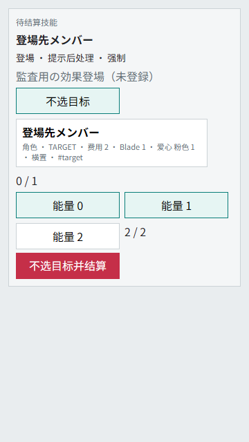

# 非公开手牌筛选：零目标选择验证

## 结论与范围

补齐受控效果登場底座中的“有符合条件的手牌也可以不选”。这是 **未登记 AUDIT 技能的执行能力**，
不是新增实际卡牌支持。`PL!-PR-015:1` / `PL!SP-PR-020:1` 和虹咲四条仍为 manual；
登记仍为 **899/1212（74.17%），313 manual**，没有提高 reviewed 状态。

完整重叠、离场观察者和继承时点留给父任务 `effect-overlap-trigger-and-private-choice`。
本批独立子任务为 `effect-private-filtered-hand-choice`，继续使用同一分支 / Draft PR #54。

## 固定官方依据

只读本地综合规则 ver.1.06，第10–12页；未抓取官网、未引入 FAQ。
PDF SHA-256：`c4f6881dcac15f69614799560fe8a327c878d4ccd8e41c85cc1d970e697ce485`。

| 条款 | 本次处理 |
|---|---|
| 9.6.3.1.4 | 未公开的非公开区域按卡牌信息筛选，即使有符合卡也可不选 |
| 9.6.2.3 | 这不是拒绝发动；费用照常支付，支付后也不能退回 |
| 9.6.2.4.2.1 | 真正选中 Member 才要求合法登場区域；零目标不得伪造区域 |
| 10.1.2 / 10.4.1 | 重叠规则处理在检查时点，不等于立即覆盖一个 Member |
| 9.7.4 | 区域移动诱发与移前信息需要独立审计，不能用本切片宣称完成 |

## 明确的 snapshot 策略

新增可选 `EffectChoice.selection_policy = private_filtered_may_choose_none`。
仅支持己方手牌、按 Member 信息筛选、固定选1张、单个 `deploy_selected_to_stage` 操作；
不用于费用选择、公开控室、对手手牌、分支、多目标或其他 operation。

原始卡文数量仍保存为1，Rule Engine 向 LegalAction 暴露有效范围0–1。
策略缺省为 None 且不序列化，旧 snapshot 的形状、必选数量与 Replay 不变。
不升级 Card Schema、MatchState 顶层字段或 runtime SQLite schema；不改 importer / 卡库 / registry。

## 状态验证

先复现旧 LegalAction 强制最少1张的失败，再实现策略；专项共 **38项**。

| 场景 | 期望与实际 |
|---|---|
| 有符合 Member，选择零张 | 手牌、旧 Member、附属卡不变；支付2 Energy，结束本技能 |
| 没有符合 Member | 仍可选零张，不制造目标、不退费 |
| 没有合法登場区域 | 不强行覆盖；只允许零目标完成 |
| 选1张与合法区域 | 正常登場并走既有受控清理 / 触发路径 |
| 起动 → 支付 → 读取 SQLite → 选零张 | 费用只付一次，旧手牌不公开，Replay 最终状态一致 |
| 拒绝可选发动 | 记录 effect_declined，不支付费用，与零目标完成不同 |
| 零张却提交区域、选中却没区域、重复 / 非法 / 对手卡、漏费用 | 拒绝且原状态不变 |
| 旧手牌 snapshot、公开控室必选 | 不自动获得零张权利，旧 shape / hash 保持 |
| 三种 Simple AI、deterministic 脚本 | 有目标、无目标、无区域均能合法推进，不用 skip 或手动兜底 |
| 双方视角 | 未选择手牌不进入对手卡牌字典或事件，候选 LegalAction 只给操作人 |

零目标完成记录 `effect_operation_not_applied / private_selection_none` 后正常 `effect_resolved`，
不记录错误跳过，不包含“手里到底有没有符合卡”的候选详情。
新策略只处理已明确的非公开筛选边界，不宣称所有私有区域 / 公开手牌规则都已支持。

## 画面与可操作性

新增“选择不选目标 / 選ばない”入口，以及零张时“不选目标并结算 / 対象なしで解決”。
选中 Member 后显示区域；取消选择后不再提交之前的区域，费用选择仍保留。
3项组件测试验证零张、有目标转零张、选1张的原生 payload，并验证未支付时不能提交。

独立组件 Playwright 共8组：360×640、390×844、430×932、1280×900，各测有 / 无目标。
确认按钮在视口内、无横向溢出、无页面错误，提交0张与2 Energy且不携带区域。
已检查下方实际截图；这不是整局手机版验收，也不是正式卡牌技能成功截图。

完整8张截图留在本机 `logs/continuous-private-hand-choice-ui-20261025/`，临时浏览器和端口已关闭。

## 固定 AI 回归

20 Deck 池、seed 12000–12009，10局、600 action cap：

| 局 | Deck | 回合 | 双方成功 Live |
|---|---|---:|---|
| 1 | 01 / 04 | 3 | 2 / 3 |
| 2 | 02 / 09 | 6 | 1 / 3 |
| 3 | 03 / 14 | 6 | 3 / 1 |
| 4 | 04 / 19 | 7 | 3 / 2 |
| 5 | 05 / 04 | 19 | 2 / 3 |
| 6 | 06 / 09 | 7 | 0 / 3 |
| 7 | 07 / 14 | 8 | 3 / 1 |
| 8 | 08 / 19 | 6 | 1 / 3 |
| 9 | 09 / 04 | 5 | 3 / 1 |
| 10 | 10 / 09 | 5 | 3 / 0 |

10/10完赛、平均7.2回合、最长19；无 blocker / skip / Replay序列化错误。
严格“10回合内且双方至少1次成功 Live”仍为7/10，不宣称 AI 策略改善。
因没有正式卡牌绑定新策略，随机池只是回归；38项定向状态测试才验证本次新能力。
原始报告留在 `logs/continuous-private-hand-choice-ai-20261025/`，不上传私有对局日志。

## 仍未完成

当前每区域单个顶部 Member 的状态结构不能表达任意临时重叠及其间的常时条件。
既有 `outgoing_effect_requires_overlap_timing_review`、`entry_condition_requires_overlap_timing_review`
和附属能力等拒绝边界不放宽；父任务继续实现 / 审计检查时点、最終情報和 AP/NAP 自动能力排序。
上述六条 manual 必须逐卡通过真实状态、Replay、AI、UI 后才能晋级，本轮没有恢复旧标签。
不把程序测试称为完整人工裁定，不合并、不部署，不启用 Cloud。
